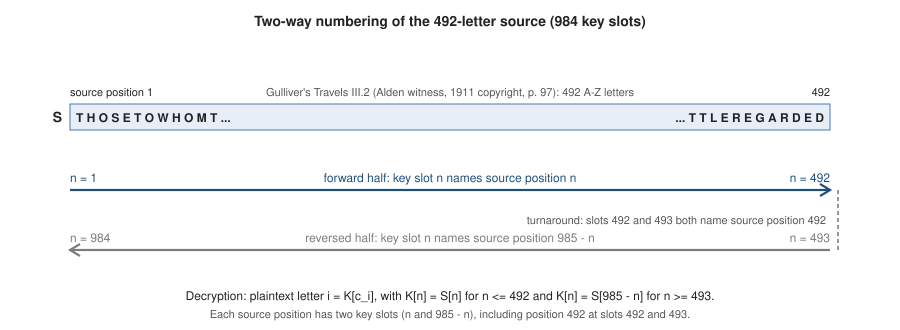
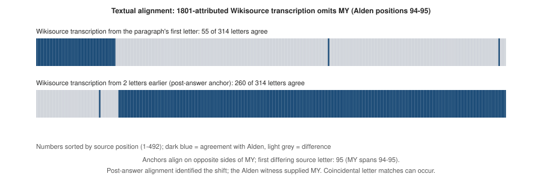

# An Independent Reconstruction of Decipher II, Message 1 (1985–86)

**Christopher A. Eckman**

Independent Researcher

ORCID: [0009-0008-3325-4513](https://orcid.org/0009-0008-3325-4513)

*Non-peer-reviewed research report.*

## Abstract

Decipher II, Message 1, a numerical cipher published in 1985, was solved by contestants in 1986. Contemporary reporting identified *Gulliver's Travels* as the source book and *Bloom County* as the subject of the message, but did not document the passage or numbering method. This report reconstructs a working key from a passage in Part III, Chapter 2 of Swift's novel. Normalization yields 492 letters; concatenating that sequence with its reversal produces a 984-position key. Applied to a corrected transcription of the 314-number ciphertext, the key recovers a complete message referring to *Bloom County*. The reconstruction is checked through per-character correspondence, reproducible Python software, and comparisons with alternative source windows. A two-letter discrepancy between an inspected printed text and a second transcription explains an important alignment problem. The result provides a transparent, testable technical account of the historically solved cipher. One ciphertext reading remains probable rather than certain, and the designer's exact edition and procedure for choosing numerical positions remain unknown.

**Keywords:** historical cryptanalysis; book cipher; literary key; textual variants; reproducibility; Decipher II.

## 1. Introduction and historical record

Decipher II, Message 1 was solved by contestants in 1986, but the contemporary reporting examined for this study did not explain the complete decoding method. A March 1986 newspaper account identified *Gulliver's Travels* as the source book, connected the clue “492” to a passage in the text, and described the decoded message as a poem about *Bloom County* (Forstrom 1986). However, it did not identify the specific passage or explain how its letters were used to construct the numerical key. This paper reconstructs the passage and key construction and presents a reproducible decoding of the 314-number message.

The designation II-1 refers throughout to Decipher II, Message 1. The photographed puzzle bears a 1985 copyright notice. Forstrom's *Statesman Journal* report of 25 March 1986 names Eileen Novak and reports three other successful solvers, each receiving $6,250. Their historical solution predates the present work by four decades. This paper does not claim to be the first solution of II-1. Its purpose is to reconstruct an explicit source representation and numerical rule, document the resulting ciphertext-to-plaintext correspondence, and identify the evidential limits of that reconstruction.

Karen Kavett's community compilation provides the transcription, puzzle photograph, clues and historical-source material used in the investigation. The umbrellaid repository provides additional traceable community research and an earlier public correction of one ciphertext integer. Baldwin and Sherman's published account concerns Decipher I, a different competition puzzle; it is historical context rather than a published II-1 solution (Kavett n.d.; umbrellaid 2026; Baldwin and Sherman 1990). Complete solutions to other Decipher messages are not evidence of a complete II-1 publication.

The contribution is an explicit reconstruction of the literary passage, numbering rule and corrected-input decoding, reproduced within the research team. Whether the complete II-1 plaintext or mechanism appeared in an earlier publication remains unresolved because relevant archives were inaccessible or unexamined. No first-publication priority is claimed.

**Table 1. Historical attribution and scope of the reconstruction.**

| Finding | Historical or research attribution | Scope of the present result |
|---|---|---|
| Original solution | Eileen Novak and three other 1986 contestants | Historical solution credit retained |
| Identification of the key book | Contemporary 1986 reporting | Passage and numbering rule subsequently reconstructed |
| Published 388 correction | umbrellaid | Earlier public report credited |
| Modern reconstruction | AI-assisted research directed by the author | 492-letter passage, 984-position construction and 314-character working-input decoding; prior complete publication unresolved |
| Designer's edition and position selection | Not established | Compatible printed witness; exact physical edition and numerical choices unknown |

## 2. Materials and transcription

The materials comprise 314 numerical observations, a puzzle photograph and two textual witnesses of the source paragraph. The original numerical transcription is publicly accessible in Kavett's [“Puzzle 2-1” compilation](https://docs.google.com/document/d/1SDRvq1iRa3oLxaSSMoG_iy1klczI2tFsN7gvgDl7pcE/edit) (Kavett n.d.). It is preserved separately from the corrected input. The corrected integers range from 1 to 980, within the 984-position key, and include 261 distinct values; the original transcription has 259. Source representations and locators are listed in Supplementary Table S1.

Two numerical changes are applied (Table 2). Position 306 changes from 338 to 388. Photographic evidence supports the middle digit, and umbrellaid is credited with its earlier public report on 6 October 2026. Local re-derivation does not supersede that public priority. Position 169 changes from 330 to probable 830. The four AI readings supporting 830 were candidate-aware, rather than blind human examinations; 330 remains a documented competing transcription. The claim of complete decoding is conditional on this corrected working input.

**Table 2. Working transcription changes and evidence status.**

| Observation | Original→working | Status | Attribution/exposure |
|---|---|---|---|
|169|330→830|Probable; 330 retained as competitor|Four AI readings were candidate-aware; not blind human verification|
|306|338→388|Verified photographed reading|First public report umbrellaid; local re-derivation later|

The source passage was identified in Part III, Chapter 2 of *Gulliver's Travels*, using the text printed in Raymond Macdonald Alden's *Readings in English Prose of the Eighteenth Century* (copyright 1911, p. 97). This version produces the required 492-letter sequence. An online transcription attributed to an 1801 edition omits the word “my,” resulting in a 490-letter sequence. The discrepancy and its effect on decoding are examined in Section 5. The exact edition used by the puzzle's original designer remains unknown.

## 3. Key construction and verification method

### 3.1 Source representation and key construction

The compatible paragraph describes a tailor measuring Gulliver and producing ill-fitting clothes through a numerical error. A compatible source transcription is provided in Appendix A and as a separate literary-source input. Let P denote that transcription. Normalization applies Unicode NFKD, converts to uppercase and retains only ASCII A–Z. Spaces, punctuation, digits and line breaks are removed; printed line-break hyphens are removed with the other nonletters. The resulting source sequence S contains 492 letters. Its concatenation with its reversal produces K, a 984-position key.

```text
N(P) = retain_ASCII_A_to_Z(uppercase(NFKD(P)))
S = N(P) = s_1 ... s_492                 |S| = 492
K = S || reverse(S)                     |K| = 984

k_n = s_n             for 1 <= n <= 492
k_n = s_(985 - n)     for 493 <= n <= 984

sigma(n) = n          for 1 <= n <= 492
sigma(n) = 985 - n    for 493 <= n <= 984

p_i = k_(c_i) = s_(sigma(c_i))           for 1 <= i <= 314
```

Here `||` means concatenation, c_i is the corrected integer at observation i, and p_i is its decoded letter. The mathematical indices are one-based; the implementation performs lookup with `key[n - 1]`. Key positions 492 and 493 both denote the last source letter, and positions 1 and 984 both denote the first. More generally, n and 985−n address the same source position. The duplicated turnaround is part of the construction, not an off-by-one omission.



**Figure 1.** Construction of the 984-position key by appending the reversal of the 492-letter source. Key slots n and 985−n address the same source position. Slots 492 and 493 duplicate the turnaround at source position 492.

The construction supplies multiple eligible numerical positions for a plaintext letter. If H(x) is the set of positions carrying letter x, then `|H(x)| = 2 * |{j : s_j = x}|`. This determines the available homophones, but it does not identify the designer's procedure for choosing among them. Specifying the key and reproducing a recorded integer choice are different from recovering a unique enciphering algorithm.

### 3.2 Correspondence, verification and coverage

The verifier accepts the ciphertext transcription, correction specification and source transcription. It checks correction preconditions, requires a 492-letter normalized source, constructs the key and writes the decoded output and a per-observation correspondence table. The proposed plaintext is not an input to the decoding program. Its recorded output hash can be compared after decoding, which is distinct from supplying plaintext during inference. Repeated integers must decode identically under any fixed key, so that consistency check is a sanity check rather than independent proof of correctness.

Aggregate correspondence coverage is reported in Table 3. The complete ordered table is not distributed because its decoded-letter column reproduces the message; the data-availability statement specifies the source-referenced reproduction route.

**Table 3. Observation and key-position coverage.**

| Quantity | Observed / defined | Unexercised |
|---|---:|---:|
| Decoded observation positions | 314 / 314 | 0 |
| Underlying source positions | 224 / 492 | 268 |
| Numbered key slots | 261 / 984 | 723 |
| Forward-half observation occurrences | 161 | — |
| Reverse-half observation occurrences | 153 | — |

Under the corrected working ciphertext transcription, the reconstructed key accounts for all 314 decoded characters. The complete construction is mathematically specified and reproducible from the verified source representation. The observed message exercises 224 of 492 underlying source positions and 261 of 984 numbered key slots. The remaining mappings follow from the construction rule and have not been independently authenticated against the designer's complete historical key.

Verification establishes an internally reproducible reconstruction under the stated inputs and assumptions. The designer's exact physical edition and process for selecting eligible numerical positions remain unknown. The reconstruction does not establish every original design choice, universal uniqueness or historical priority.

Supplementary Table S2 summarizes verifier checks and within-team reproduction, with byte conventions and hashes in Table S2b. Matching hashes establish representation equality, not historical priority or authentication of unused mappings.

### 3.3 Human-directed iterative research workflow

Research proceeded iteratively through hypothesis development, software implementation, experimental execution and analysis, and human review of subsequent research direction. Specialist agents conducted work within the scope established by the author. Separate implementations and adversarial checks used shared clues and research context; they provide within-team verification rather than external independent replication.

## 4. Discovery and experimental exposure

Initial one-way and word-initial searches failed to recover the actual construction. Their known-positive controls detected an exact plant but missed a two-edit plant (E115, E118, E119). Identifiers of the form E followed by digits denote entries in the project's experiment log; the cited results and discovery events are summarized in Supplementary Tables S4 and S5. These results limited the represented search procedure; they did not reject literary-key mechanisms generally.

On 11 October 2026, the author redirected the investigation toward missing mechanisms and mistaken assumptions. Cryptanalysis and historical-design agents then proposed and implemented bidirectional numbering. Exploratory analysis of numerical folding provided related case evidence, although shared clues and exchanges preclude treating these routes as independent.

The passage search located the tailor paragraph. Computational alignment and proposed digit changes followed the initial decoding; the printed witness and photograph were then consulted to evaluate them. Greedy repair failed, and a promising candidate remained below a predefined acceptance threshold. These post-answer examinations were not blind verification of the source or uncertain digit (Supplementary Table S4).

A separate implementation subsequently reproduced the supplied-rule result within the team. Expanded GPU checks were configured after mechanism identification to test known-answer agreement and search behavior. Supplementary Table S5 gives the chronology of the passage search and within-team reproduction.

## 5. Results and textual-witness alignment

The reconstruction defines the 492-letter source and 984-position key and yields a literal 314-character output, without inserted tokens, spelling repairs, punctuation or inferred line divisions. The corrected and uncorrected outputs differ only at observations 169 and 306. Completeness under the working transcription therefore remains conditional on the probable 830 reading at observation 169. The message takes the form of a tribute to *Bloom County*, consistent with the contemporary report. The complete poem is not reproduced here; it can be generated locally using the externally obtained numerical input, correction specification and verifier.

The opening 21 characters of the reconstructed plaintext are reproduced exactly, without spaces, punctuation or editorial corrections (Decipher, Inc. 1985; Kavett n.d.):

```text
INHOMAGETOBLOOMCOUNTY
```

This sequence can be read as “In homage to Bloom County”; the word spacing is editorial interpretation rather than part of the original cipher output. The remainder of the poem is not reproduced.

The literal uppercase output, serialized as ASCII without separators or a trailing newline, has SHA-256:

```text
859f2c3458025e03ad8a425b8e9b9e16f152927b8b34e33300ad1d49d065ee1f
```

Textual alignment explains why identifying the passage did not immediately yield complete decoding. The 1801-attributed Wikisource transcription reads “take measure,” whereas the inspected Alden page reads “take my measure.” Their normalized paragraphs contain 490 and 492 letters, respectively. Two 492-letter windows drawn from the Wikisource representation illustrate the addressing problem: the paragraph-start window agrees at 55 of 314 observations, while an anchor two letters earlier agrees at 260. Each aligns on a different side of the discrepancy, so a single global offset does not repair every observation.

**Table 4. Alignment of the inspected Alden paragraph and the 1801-attributed Wikisource transcription.**

| Witness/anchor | Source letters or agreement | Interpretation limit |
|---|---:|---|
| Matching Alden witness |492|Compatible printed witness; exact designer edition unconfirmed|
|Wikisource, paragraph-start window|490-letter paragraph; 55/314 agree|Transcription lacks the two-letter word; addressing shifts|
|Wikisource, anchor 2 letters earlier|260/314 agree|Aligned on a different side of the gap; coincidental letter matches may occur elsewhere|
| Post-answer alignment and page check |One 2-letter shift; MY at source positions 94–95; first differing letter at 95|Alignment identifies discrepancy; printed witness supplies actual word|



**Figure 2.** Agreement of two 492-letter windows in the 1801-attributed Wikisource transcription with the Alden-based decoding: 55/314 and 260/314 observations. Cells are ordered by source index; dark blue denotes agreement and light gray disagreement. Post-answer alignment identified the shift, while the inspected printed witness supplied MY. Coincidental matches can occur outside aligned regions; this comparison does not verify a difference between historical printings.

MY occupies source positions 94–95. Position 95 is the first differing normalized letter because M at 94 coincides in both representations. Alignment identifies a two-letter shift but does not supply the missing letters; the Alden page provides them. The Alden page image and its OCR text layer derive from the same Internet Archive scan. Because the original 1801 page was not inspected, the discrepancy may arise in transcription rather than in the historical printing. Neither this comparison nor the compatible Alden witness identifies the designer's physical edition (Swift 1911; Swift n.d.).

## 6. Alternatives, controls and robustness

Verification is supplemented by alternative-window and rule-family controls using the Wikisource representation with MY restored. A character Kneser–Ney 5-gram model trained on a project-assembled English Wikisource reference corpus ranks candidate decodings. Its training collection contains 151 documents and 2,040,211 normalized letters. Dictionary segmentation supplies a complementary coverage measure using 10,911 words occurring at least three times in the combined training and development collections. The corpus contains literary and official-government texts; its composition, preprocessing and split are described in Supplement §3. The corpus and trained scorer are not distributed. This measure has explicit lexical and corpus assumptions.

The five extraction families and their numerical results appear in Supplementary Table S3. F1 applies two-way letter numbering with half-length 492; F1u uses the uncorrected input. The comparison families use contiguous letters or word initials. Coverage is evaluated for the true window, language-model-selected top 50 alternatives and 2,000 random windows per family (seed 20261011).

Within F1, the true window ranks first, with score −3.7977 against −5.2765 for the best other window. It also ranks first under uncorrected input. Under the reported settings, dictionary coverage is 0.6529 for the true window, compared with a maximum of 0.3662 among the language-model-ranked top 50 alternatives. These are case-specific contrasts within the supplied book and tested families. They do not establish that all possible texts or key constructions were searched, or provide a universal probability that the reconstruction is correct. The corrected source representation used in these controls is also part of the investigation's exposure history.

Supplementary Table S4 reports additional controls, negative results and experimental exposure.

The selected wrong-passage repair control gives 40 high-ranking alternatives a generous automated repair budget. Its best wrong passage reaches −4.93, compared with −3.75 for the true passage under the reported repaired setting (E183). That conditional contrast addresses whether the particular repair strategy readily makes selected wrong passages convincing. Selection of the alternatives and limits of the repair search prevent treating it as an exhaustive proof of uniqueness.

Known-answer CPU/GPU checks agree on the key and decoding hashes. The known-source search ranks the true candidate first among 16,345,616 hypotheses (E219). This is distinct from the F1 whole-book window control and from the strict search on the unmodified Wikisource representation (E220). The strict search evaluates 20,074,744 hypotheses and ranks a window two letters before the recorded paragraph anchor first; it does not recover the exact construction at that anchor. A separate 8,386,852-hypothesis post-answer alignment stage accommodates the two-letter shift but cannot determine the missing letters. These searches were supplied the book and relevant mechanism or length information after the answer was known; they are not blind discoveries. Supplementary Table S4 retains the nearby-window result and exact-anchor ranks.

Calibration experiments also exposed limitations of the search. E141 found nine exact planted controls but failed its locked actual-result acceptance gate. Later refinement did not retroactively convert that gate into a pass. E231's five one-edit and five two-edit trials yielded zero exact recoveries in each group, despite some high partial agreement. Exact recovery, partial agreement and language-model score are different outcomes. Retained failed calibration gates preclude a validated general detector claim.

The ciphertext fold statistic is exploratory. For the reported d=1 version, the peak at R=984 contains ten qualifying pairs; its reported permutation p-value is 0.0005 at the floor of 2,000 shuffles. Multiple analyst-selected variants and clue-informed mechanism choices preceded the final statistic. Its within-statistic search correction does not account for every exploratory choice. Supplementary Figure S4 is therefore contextual evidence for this case, not a calibrated universal test.

The original reversal fixture was nondiscriminating; a supplemental test with a varied non-palindromic source passed three checks. The fixture defect and the no-reversal and missing-turnaround controls are described in Supplement §2 and Table S4. Control plots appear in Supplementary Figures S2–S4.

## 7. Historical interpretation and limitations

The literal decoding contains PISTACHIO, but not YAZ. A *Bloom County* strip reproduced in the 15 July 1983 issue of *The University Daily* documents the character Yaz Pistachio before the competition (Breathed 1983). The association with the decoded token is contextual interpretation, rather than an additional decoded name or proof of the puzzle designer's intent.

Similarly, BRINKLEY is retained as encoded rather than silently changed to the likely intended Binkley. The observed letters and their editorial interpretation are different evidence types. The reconstruction also does not determine the poem's original punctuation or layout, or resolve the additional printed clue “S.I.N.” in the original puzzle (Decipher, Inc. 1985; Kavett n.d.). Compatibility with the known theme supports the historical account without supplying missing numerical evidence.

The principal mathematical limitation is coverage. The complete rule determines a value for every constructed key position, but the message exercises only a subset. Compatible unused mappings must not be described as independently authenticated designer mappings. Different physical editions with the same normalized paragraph would produce the same key, and multiple eligible integers exist for each letter. The result consequently cannot select a unique original edition or numerical-choice procedure.

Prior complete publication remains unresolved because the source investigation was access-bounded. The reconstruction is supported by deterministic correspondence and within-team reproduction, but some historical software versions and execution records are incomplete. The controls consequently have narrower reproducibility than the fixed decoding. Contemporary newspaper pages were examined earlier through the community archive but are not retained for full-page reinspection. Supplementary Table S6 summarizes these scientific and source-access limitations.

## 8. Conclusion

The Decipher II-1 reconstruction recovers a compatible literary source representation, a fully specified bidirectional numerical construction and a complete 314-character output under the corrected working transcription. The 492-letter tailor paragraph and its reversal explain the 984-position key, while textual alignment accounts for a two-letter witness discrepancy. Per-observation correspondence, internal reproduction and scoped controls support the reconstruction without removing the uncertainty of the probable 830 reading.

The contribution is an explicit modern technical reconstruction with documented computational verification. Original solution credit remains with the 1986 contestants, and umbrellaid is credited for the earlier public 388 correction. The result does not authenticate unused historical mappings or determine the designer's exact edition and numerical-selection procedure; prior complete publication remains unresolved.

## AI Use and Author Contributions

Christopher A. Eckman designed and operated the AI-assisted research process and served as the human research director. AI tools contributed to hypothesis development, software engineering, experimental execution and analysis, source research, and manuscript drafting and editing. OpenAI Codex and Claude Code supported computational investigations; Gemini assisted with source research; ChatGPT supported checking and contextual interpretation, including the identification of Yaz Pistachio. OpenAI Codex generated first-draft manuscript text and assisted with subsequent editing. Internal AI-assisted review was used, but the report has not undergone external peer review.

## Funding and competing interests

**Funding:** No external funding.

**Competing interests:** No competing interests.

## References

Baldwin, Robert W., and Alan T. Sherman. 1990. “How we solved the $100,000 Decipher puzzle (16 hours too late).” *Cryptologia* 14(3): 258–284. [https://doi.org/10.1080/0161-119091864968](https://doi.org/10.1080/0161-119091864968).

Breathed, Berke. 1983. “Bloom County” [comic strip; internal mark 6–27]. *The University Daily*, Texas Tech University, Lubbock, July 15, vol. 58, no. 154, PDF p. 2. Southwest Collection/Special Collections Library, Texas Tech University. [Digitized newspaper issue](https://newspapers.swco.ttu.edu/server/api/core/bitstreams/3fc5e690-8435-4711-a6cb-bfda13e772d3/content).

Decipher, Inc. 1985. *Decipher II*, Message 1 [jigsaw-puzzle message]. Photograph reproduced in Kavett's “Puzzle 2-1” compilation.

Forstrom, Tom. 1986. “Decipher II game pays off in cold cash.” *Statesman Journal*, March 25, pp. 1B and 3B.

Kavett, Karen. n.d. *Decipher II and III Puzzles* [community research compilation], “Puzzle 2-1.” [Google document](https://docs.google.com/document/d/1SDRvq1iRa3oLxaSSMoG_iy1klczI2tFsN7gvgDl7pcE/edit). Retrieved October 11, 2026; public access rechecked October 13, 2026 UTC.

Swift, Jonathan. 1911. *Travels into Several Remote Nations of the World* (*Gulliver's Travels*), Part III, Chapter 2. In *Readings in English Prose of the Eighteenth Century*, edited by Raymond Macdonald Alden, p. 97. Boston, New York and Chicago: Houghton Mifflin. Copyright date; scanned copy's printing date unestablished. [Internet Archive scan](https://archive.org/details/readingsinenglis00alde), PDF p. 115.

Swift, Jonathan. n.d. “Gulliver's Travels,” Part III, Chapter 2. Wikisource transcription attributed to *The Works of the Rev. Jonathan Swift*, vol. 6, London, 1801. [Transcription](https://en.wikisource.org/wiki/The_Works_of_the_Rev._Jonathan_Swift/Volume_6/Gulliver%27s_Travels). Retrieved October 11, 2026. The 1801 printed page was not inspected.

umbrellaid. 2026. *decipher-money-hunt-research* [research repository]. [GitHub](https://github.com/umbrellaid/decipher-money-hunt-research). Correction first publicly recorded October 6, 2026; corresponding rewritten revision `8889ffbbd9b351e9767fdcd70893c5775531beb9`.

## Appendix A. Compatible literary source

This paragraph is transcribed from the inspected Alden witness (Swift 1911, p. 97). The underlying Swift literary text is public domain; no scan or editorial apparatus is reproduced. The transcription is a compatible source, not evidence identifying the designer's edition. Normalization is specified in §3.1.

> Those to whom the king had entrusted me, observing how ill I was clad, ordered a tailor to come next morning and take my measure for a suit of clothes. This operator did his office after a different manner from those of his trade in Europe. He first took my altitude by a quadrant, and then, with rule and compasses, described the dimensions and outlines of my whole body, all which he entered upon paper, and in six days brought my clothes — very ill made, and quite out of shape, by happening to mistake a figure in the calculation. But my comfort was that I observed such accidents very frequent, and little regarded.

## Data and code availability

The accompanying materials contain the literary-source transcription, a standalone text-only Python application, the fixed verifier, correction specification, synthetic tests, aggregate results, hashes, figures and [supplement](PUBLIC_SUPPLEMENT.md). The complete poem, numerical ciphertext, ordered correspondence, source images and private transcripts are not redistributed. The source paragraph and construction nevertheless enable decoding of ciphertext obtained elsewhere.

Actual-message reproduction requires separately obtaining the 314-number transcription from Kavett's [“Puzzle 2-1” section](https://docs.google.com/document/d/1SDRvq1iRa3oLxaSSMoG_iy1klczI2tFsN7gvgDl7pcE/edit). The supplied `decode.py` application requires Python 3.10 or later and only its standard library. It authenticates the entire original numerical sequence against the recorded input fingerprint before applying the documented working corrections, delegates construction and decoding to the verifier, checks the output hashes and correspondences, and writes results to a new local directory. No image recognition, model, GPU, network service or additional package is used. The [README](../README.md) provides copying instructions, platform-specific commands, expected hashes, output locations and troubleshooting.

This source-referenced workflow is not a fully self-contained historical data bundle. Source/key integrity checks and synthetic tests run using only the public files; exact replay of every historical whole-book or GPU search is not supported. Hash equality does not independently resolve the probable 830 reading.

Verification software version 1.0.0, the public supporting files and their SHA-256 manifest accompany this report. The project repository is [decipher-ii1-reconstruction](https://github.com/chriseckman/decipher-ii1-reconstruction). The accompanying archive contains the report, supplement and fixed software snapshot.

Original report, supplement and figure material © 2026 Christopher A. Eckman is licensed under [Creative Commons Attribution 4.0 International](https://creativecommons.org/licenses/by/4.0/), except where otherwise identified. The quotation in §5 and other third-party quotations are excluded. The underlying Swift literary text is public domain. Original project-owned verification software is licensed separately under the MIT License.
