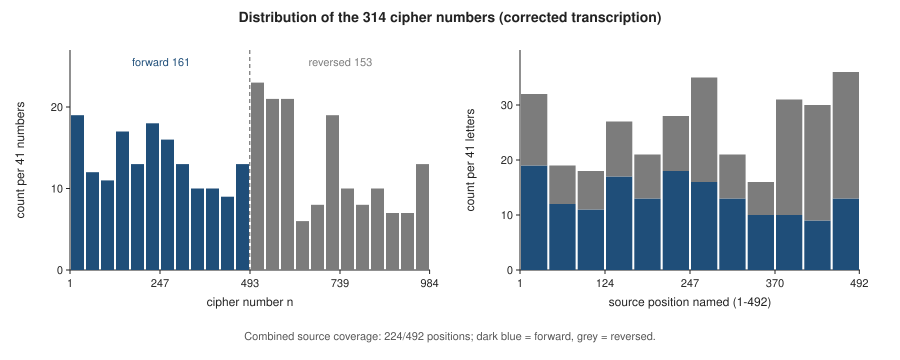
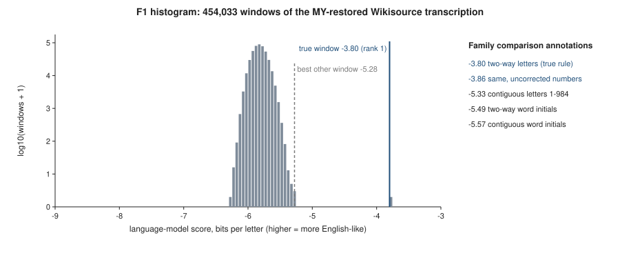
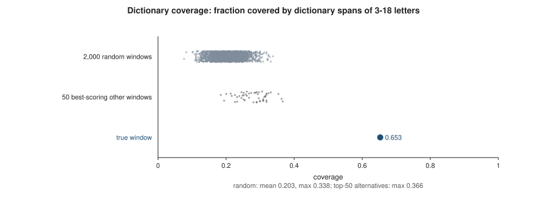
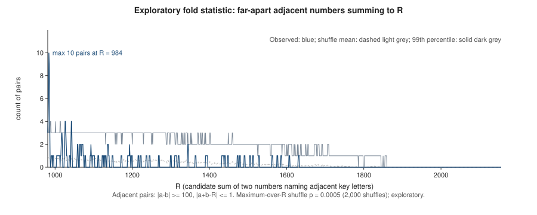

# Decipher II-1 — supplementary methods and evidence

This supplement provides the reconstruction's mathematical definitions, implementation checks, controls and evidential limitations. The complete ciphertext, decoded poem, ordered correspondence and original source images are not redistributed. Research and writing assistance are described in the [AI Use and Author Contributions disclosure](AI_USE_DISCLOSURE.md).

## 1. Fixed mathematical construction

Let P be the compatible tailor paragraph in *Gulliver's Travels*, Part III, Chapter 2, as transcribed from Alden's anthology (copyright 1911, printed p. 97; scan PDF p. 115). The source is included as [source_transcription.txt](../inputs/source_transcription.txt). Unicode NFKD normalization, uppercase conversion and retention of ASCII A–Z yield S of length 492. Deleting nonletters also removes spaces, punctuation, digits, line breaks and printed line-break hyphens.

```text
S = retain_ASCII_A_to_Z(uppercase(NFKD(P)))
K = S || reverse(S)                     |K| = 984
sigma(n) = n          for 1 <= n <= 492
sigma(n) = 985 - n    for 493 <= n <= 984
p_i = S[sigma(c_i) - 1]                 for 1 <= i <= 314
```

The mathematical source indices are one-based; the array expression uses zero-based lookup. Positions 492 and 493 name the same last source letter; 1 and 984 name the same first letter. For a letter x, the number of eligible numerical slots is twice its occurrence count in S. The rule does not specify the designer's choice among eligible positions.

The corrected recorded input has 314 observations, 261 distinct numbered slots and 224 distinct underlying source positions. Forward and reversed occurrences number 161 and 153. Their distinct source-position sets have sizes 139 and 122, overlap at 37 positions and have union size 224. The 268 unused source positions and 723 unused slots follow from the construction, not an authenticated historical complete key.

Source, key and literal-output SHA-256 values appear in [aggregate_results.json](../aggregate_results.json). They use uppercase ASCII without separators or a trailing newline. Hash agreement establishes byte identity; it does not establish historical priority or uniqueness.

## 2. Implementation and public-only checks

[ii1_verify.py](../code/ii1_verify.py) uses the Python standard library to parse 314 integers, apply corrections with original-value preconditions, require a 492-letter normalized source, construct K and decode. It writes the source, key, literal output, ordered correspondence and verification metadata to a new directory. The proposed plaintext is not an input. Fixed-key repeated-number consistency is a sanity check, not independent proof of the source.

The [text-only application](../decode.py) authenticates the original 314-number transcription before applying either correction, invokes this verifier and checks the generated hashes and every correspondence row before saving results. It accepts a reader-created text file; the literary paragraph is already supplied. Its [README](../README.md) documents the one-command workflow and new output-directory requirement. The project repository is [decipher-ii1-reconstruction](https://github.com/chriseckman/decipher-ii1-reconstruction). The accompanying software archive is version 1.0.0; its files and hashes are listed in MANIFEST.json.

The supplied [correction specification](../inputs/corrections.json) changes observation 169 from 330 to probable 830 and observation 306 from 338 to 388. The former retains 330 as the competitor; four recorded AI readings were candidate-aware. The latter is supported by the photograph and credited to umbrellaid's earlier public correction. Photographs and ordered outputs are withheld. Hash checking cannot adjudicate the uncertain digit by itself.

An earlier, undistributed eleven-test suite passed, but its repeatedly initialized `random.Random(1)` reversal fixture was constant and could not discriminate reversal. A subsequent three-check test used a varied non-palindromic sequence, accepted the intended reversal and rejected no-reversal and missing-turnaround mutants. This supplemental test does not retrospectively validate the original nondiscriminating fixture. The bundled synthetic tests also cover source-length rejection, normalization, one-based mirror addressing, correction positions and preconditions, correspondence labels, output-directory protection and command-line behavior. The checkers refuse optimized Python execution so that disabled assertions cannot yield a false pass. Synthetic checks do not reproduce the actual message without its numerical input.

The [README.md](../README.md) provides commands for source/key consistency checks and synthetic software tests. Actual-message reproduction additionally requires the 314-number transcription from Karen Kavett's [“Puzzle 2-1” section](https://docs.google.com/document/d/1SDRvq1iRa3oLxaSSMoG_iy1klczI2tFsN7gvgDl7pcE/edit) (Kavett n.d.). Public access and sequence agreement with the original input were checked on 13 October 2026 UTC. The README specifies input preparation, corrections and output-hash checks. No actual-message input is bundled. Historical search and GPU implementations, trained scorers and corpora are not distributed, so the released files do not reproduce those exploratory searches.

## 3. Alternative-window controls and exposure

The window controls use the 1801-attributed Wikisource transcription with MY restored, rather than an unmodified transcription or an inspected original printed edition. Tested families are two-way letters at half-length 492 (F1), that rule on uncorrected input (F1u), 984 contiguous letters (F2), two-way word initials (F3), and contiguous word initials (F4). The counts are respectively 454,033, 454,033, 453,541, 104,189 and 103,697 windows. The F1 correct window ranks first at −3.7977 bits per letter versus −5.2765 for its best other window. This is a supplied-book, tested-family comparison, not all-source uniqueness evidence.

An interpolated modified Kneser–Ney character 5-gram model ranks candidates. It was fitted to the training collection of a project-assembled English Wikisource reference corpus: 151 documents, 475,579 words and 2,040,211 normalized letters. The separate development collection contains 38 documents, 115,347 words and 494,168 normalized letters. The collections comprise literary texts, including fiction, memoir and poetry, and official U.S. government texts, including speeches and transcripts. The preserved acquisition record identifies government works and works first published before 1931; the underlying texts are not redistributed. Preprocessing uses NFKD, lowercase conversion, deletion of internal apostrophes and treatment of other nonletters as word boundaries, with a 60,000-letter cap per document. Within each genre having at least three documents, documents were ordered by the SHA-256 of their titles and ranks 0, 6, 12 and so on were assigned to development. Only the character component of the model was used. Model order 5 was selected by held-out development cross-entropy among orders 3–5 (2.450 bits per letter at order 5); order 6 was not tried within the memory budget.

Dictionary segmentation evaluates spans of length 3–18, using a 10,911-word dictionary admitted from both collections (189 documents and 2,534,379 normalized letters), with minimum frequency three and minimum length three. The corpus and trained scorer are not distributed. Training and development file SHA-256 values are, respectively, `557042a1f5e2a4af5a8d35203281096ea8619fd2dad5ea3a9cde788c2213c5e7` and `0e6489fc7cbb1697a0e5fbf7a76366a57e9b2afc18503cc1d14ea8df4924dcd8`; the scorer file SHA-256 is `b806c2e055f9ca2b0cdce6e2647a71ad15d5df86f4d368f8531c61565a872fb3`. Coverage is computed for the true window, language-model-selected top 50 alternatives and 2,000 random windows per family. Sampling seed is 20261011. F1 coverage is 0.6529; the selected-alternative maximum is 0.3662 and the random mean, p99 and maximum are 0.2032, 0.2994 and 0.3376. Shared corpus assumptions and selection prevent treating coverage as independent or assumption-free validation.

Supplementary Figure S2 plots the F1 histogram and annotates other-family best scores. Supplementary Figure S3 presents the coverage comparisons; its display-jitter seed is 20261012. These figures summarize the control results.

## 4. Failed gates, repair controls and known-answer checks

Identifiers of the form E followed by digits denote entries in the project's experiment log, rather than published studies. Tables S4 and S5 summarize the cited results and discovery events. Table S4 reports initial and planted-control failures, the failed locked E141 gate, the selected E183 repair comparison, post-answer E219/E220 checks and E231's zero exact recoveries.

The E219 known-source rank-1 search, E220 strict search and E220 drift alignment are distinct stages (Table S4). Under corrected ciphertext, the top-ranked E220 strict window begins at 240837 under `twoway-h492-R985`, two letters before the recorded paragraph anchor at 240839. This locates the nearby passage region without recovering the exact construction at the recorded anchor. Its separate drift stage realigned a two-letter shift; it did not identify the missing letters. The F1 window-control rankings in Table S3 concern their own supplied-book and MY-restored representation. Adversarial checks and separate implementations shared clues and research context; they provide within-team verification rather than external independent replication.

## 5. Exploratory fold statistic

For consecutive original ciphertext integers a,b with `|a-b| >= 100`, count pairs satisfying `|a+b-R| <= d`. The displayed version uses d=1 and a grid from `max(c)+1` through `floor(2.2*max(c))`, here R=981–2156. The observed maximum is ten pairs at R=984. The permutation comparison keeps the number multiset and takes the maximum over R for each of 2,000 reorderings. The reported p-value is `1/2001`, approximately 0.0005. Supplementary Figure S4's pointwise mean and 99th-percentile curves are not the distribution of maxima used for that p-value.

The statistic was recomputed within the same research team using seed 20261012; this provides internal reproduction rather than external independent replication. Not all historical null-summary calculations can be reproduced from the available code and results. About ten variants and clue-informed choices preceded fixation. Multiplying the rounded 0.0005 by ten gives 0.005, but that illustration does not establish a complete correction for analyst choices or confirmatory validity. The statistic remains exploratory case evidence, not a validated general detector. The clue route and statistic route are not independent.

## 6. Textual alignment and contextual interpretation

The 1801-attributed Wikisource transcription reads “take measure”; the inspected Alden printed witness reads “take my measure” (Swift n.d.; Swift 1911). MY occupies source positions 94–95. The first differing normalized letter is at 95 because M at 94 coincides in both witnesses. The shorter paragraph has 490 letters. Recorded 492-letter-window anchors give agreement at 55/314 from the paragraph start and 260/314 from two letters earlier. Main-text Figure 2 sorts cells by source index. Each anchor aligns on a different side of the gap, although incidental letter matches can occur outside correctly aligned regions. Post-answer alignment identifies the shift; the printed witness supplies MY. The original 1801 printed page was not inspected: the omission could arise in the transcription, and is not a verified physical-edition difference. The designer's exact physical edition remains unknown.

The decoded token PISTACHIO is consistent with a reference to Yaz Pistachio, a *Bloom County* character documented in *The University Daily*, 15 July 1983, PDF p. 2 (Breathed 1983). YAZ was not decoded. The association is contextual interpretation, not an additional decoded word or proof of the puzzle designer's intent. The strip's internal 6–27 mark does not establish its first appearance or an independently verified syndication date. No strip image is redistributed.

## 7. Research chronology and reproducibility limits

Supplementary Table S5 records the human redirection at approximately 15:55 UTC, passage-search completion at approximately 16:26 UTC and successful within-team reproduction at approximately 17:03 UTC on 11 October 2026. The latter two times refer to completion and successful execution, respectively, rather than search starts or subsequent logging.

The fixed reconstruction reproduced five recorded artifacts byte-for-byte using the retained numerical input. Some historical source-code versions, model settings and execution records are unavailable; reproducing the fixed decoding therefore does not reproduce or validate every exploratory search. Because the released files omit the original numerical input and historical search software, actual-message reproduction is source-referenced and conditional, and the exploratory searches are not fully reproducible from this package alone.


## 8. Supplementary tables

### Table S1. Source and representation inventory

| Input | Representation / locator | Limits |
|---|---|---|
| Puzzle photograph |Kavett compilation image; photographed printed Message 1|Photographer/rights unknown; image seams; position 169 remains uncertain|
| Ciphertext |314 integers, range 1–980; 261 distinct after corrections; 259 before|Third-party input referenced in Kavett, “Puzzle 2-1”; original preserved locally and not redistributed|
| Working corrections |Position 169: 330 → 830; 306: 338 → 388|Confidence and public priority differ; see Table 2 of the report|
| Matching source witness |Swift III.2 tailor paragraph; Alden copyright 1911, p. 97 / PDF p. 115; 492 normalized letters|Printing/designer edition not established|
| Comparison witness |1801-attributed Swift Works vol. 6, Wikisource transcription; 490 letters|Transcription consulted, not original printed-page images; omits the two-letter word|
| Derived records |Aggregate reconstruction and control results and hashes|Internal computational evidence; historical search implementations incompletely preserved|

The 1801-attributed Wikisource transcription was retrieved at 2026-10-11T12:57:23Z; SHA-256 `7d28598801fc834ceefe03629202a8f3f04ef9388d1e8ed8d02e2b5dde7653d1`. The fingerprint identifies the examined transcription, not the uninspected original printed pages.

The Alden PDF has SHA-256 `478a7243cc6ef9b3447eee597d9bc6f2022a510a35fedf58d55d42207422bdf2`; the community compilation export, retrieved on 11 October 2026, has SHA-256 `d960bac80bde8ba9a752b100bd489c6c3d8c61e6eb9012496339e9ad9cda1e65`. These file fingerprints permit comparison with the examined representations and do not confer redistribution rights.

The retained original numerical input has SHA-256 `1e60d5d63422148b385abfd0569edb1c709308eb79d51e4195b6c8a781be2edc`. This is a file-byte fingerprint of 1,530 ASCII bytes: decimal integers joined with comma-space, then a final period and LF, without a BOM or CR. This input serialization is distinct from the uppercase, separator-free source/key/output convention. [INPUT_REFERENCE.json](../INPUT_REFERENCE.json) records the source link and byte convention; [README.md](../README.md) gives preparation instructions. A byte mismatch caused by different spacing or line endings need not mean a different number sequence; canonical serialization permits the recorded comparison.

### Table S2. Verification checks and interpretation

| Check | Result | Interpretation |
|---|---|---|
| Input/output size | 314 observations; 492 source letters; 984 constructed slots; 314 output characters |Corrected-input reconstruction|
| Correction preconditions |Original values must match before replacement|Photograph evidence remains a separate source|
| Position 169 |330 → 830 in working input|Probable 830; competing 330; candidate-aware readings are not blind human verification|
| Position 306 |338 → 388|First public 388 correction: umbrellaid, 6 Oct 2026 19:58:34 UTC|
| Key/source correspondence |Each observation names one source position and decoded letter|Fixed-key repeated-number consistency is a sanity check|
| Forward correspondence |Recorded integer choices reproduce the corrected observations|Does not uniquely identify the designer's choice among same-letter alternatives|
| Input comparison |Original and corrected outputs differ only at 169 and 306|No semantic token/spelling repair|
| Verifier inputs |Ciphertext, correction specification and source|Proposed plaintext not supplied as a verifier input|
| Byte conventions |Source/key/output uppercase ASCII, no separators/trailing newline; correspondence UTF-8/LF|Hash equality establishes byte agreement, not historical attribution|
| Internal reproduction |Successful within-team reproduction at approximately 17:03 UTC on 11 October (E133)|Supplied-rule within-team reproduction, not external independent replication|

**Table S2b. SHA-256 values.** Source, key and output use uppercase ASCII without separators or a trailing newline.

| Representation | SHA-256 |
|---|---|
| Normalized source |`9eeff566fe707e39486c1bb119d5c82f19566772706342c44803d6079faef29d`|
| Constructed key |`571b2327a0ef55d6fc74394b228ffc59e24a00f2ef6f670beb1fa08879eb5466`|
| Literal uppercase output |`859f2c3458025e03ad8a425b8e9b9e16f152927b8b34e33300ad1d49d065ee1f`|

### Table S3. Window-control results.

F1 is two-way letters with half-length 492; F1u applies that rule to uncorrected input; F2 is 984 contiguous letters; F3 is two-way word initials; F4 is contiguous word initials. Scores are the language-model scores in bits per letter, with larger, less negative values preferred. Coverage is evaluated on the true window, selected top 50 alternatives and 2,000 random windows per family, using seed 20261011.

| Family | Windows | True window | Best other window | Coverage: true / max of top 50 / random mean, p99, max |
|---|---:|---|---|---|
| F1 | 454,033 | **rank 1, −3.7977** | −5.2765 | **0.6529** / 0.3662 / 0.2032, 0.2994, 0.3376 |
| F1u (uncorrected) | 454,033 | **rank 1, −3.8617** | −5.2528 | 0.6401 / 0.3662 / 0.2018, 0.2994, 0.3503 |
| F2 | 453,541 | — | best −5.3303 | max of top 50 ≤ 0.3694 |
| F3 | 104,189 | — | best −5.4851 | — |
| F4 | 103,697 | — | best −5.5733 | — |

### Table S4. Additional validation, failures and exposure limits.

| Experiment | Result | Interpretation |
|---|---|---|
|E115|Actual II-1 key not recovered under 12-family initial grid|Negative applies to represented/searched conditions only|
|E118/E119|Exact plant found; two-edit plant missed|Known-positive failure retained|
|E141|9/9 exact plants, but actual formal gate FAILED|Promising score below its prelocked threshold; post hoc refinement distinct|
|E157|Greedy repair failed|Does not reject textual-alignment repair generally|
|E183|40 selected wrong passages repaired; best wrong −4.93 vs true −3.75; conditional gap about 1.18|Selected repair-null comparison; no exhaustive all-source proof|
|E219|Known-answer CPU/GPU hash agreement; known-source search: 16,345,616 hypotheses, true rank 1|Internal known-answer calibration and source-informed search; distinct from the F1 window control|
|E220 strict, corrected input|20,074,744 hypotheses; rank 1 at anchor 240837 under `twoway-h492-R985`, two letters before the recorded anchor 240839. At the recorded anchor, best-scoring `twoway-h491-R983`: rank 851,134; `twoway-h492-R985`: rank 17,914,747|1801-attributed Wikisource representation; supplied book and length range after answer exposure; nearby region located, exact-anchor/exact-decoding miss retained|
|E220 drift, corrected input|Separate 8,386,852-hypothesis stage reports an aligned candidate|Post-answer alignment; not a strict-search rank or blind discovery; does not identify the missing source letters|
|E231|Five 1-edit and five 2-edit trials; 0/5 exact in each group|Partial agreement is not exact recovery|
|E166/fold analysis|Variants and multiple exploratory analyst choices|Exploratory; not a validated general detector|
| Reversal supplemental test |Three corrected checks passed|Original nondiscriminating reversal fixture remains a limitation; supplemental test does not validate it retrospectively|

### Table S5. Research chronology

Times are UTC on 11 October 2026 and are shown at minute precision. Approximate times identify discovery and execution events; later logging times are omitted.

| Phase | Time or experiment | Interpretation |
|---|---|---|
| Initial failed family search | Initial one-way and word-initial searches; E115 | No actual key under the searched menu; broader families not rejected |
| Plant controls | Exact plant detected (E118); two-edit plant missed (E119) | Known-positive failure retained |
| Human redirection | Approximately 15:55 | Reconsider missing mechanisms; specialist hypotheses remain agent contributions |
| Specialist mechanism and search development | Approximately 16:17–16:26 | Within-team hypotheses and code shared inputs; promising result remained below the locked E141 gate |
| Passage-search completion | Approximately 16:26 (E156) | Tailor passage located; this is completion rather than the earlier search start |
| Text and digit repair | Approximately 16:31–16:36 | Post-answer alignment and predictions preceded source/photo examination; candidate-aware readings |
| Successful reproduction | Approximately 17:03 (E133) | Supplied-rule within-team reproduction; external independence is not claimed |
| GPU checks and location | E219/E220, after mechanism identification | Known answer, book and range supplied; post-answer search was not blind mechanism discovery |

### Table S6. Limitations

| Issue | Evidential boundary |
|---|---|
| Ciphertext position 169 | Probable 830, with 330 retained; candidate-aware AI readings are not blind human verification. |
| Unused mappings | Only 224/492 source positions and 261/984 numbered slots exercised; unused mappings are construction-derived. |
| Designer's edition and numerical choices | Exact physical edition and position-selection procedure unknown; compatible normalized witnesses and many eligible integers can yield the same reconstruction. |
| Prior publication | Original 1986 solution credited; complete prior publication not excluded by the access-bounded source search. |
| Fold and calibration | Exploratory variants and failed gates retained; no validated universal detector. |
| Internal reproduction | Shared within-team context and supplied-rule implementations; no independent external replication. |
| Historical-search reproducibility | Some exact software versions and execution records are unavailable; exploratory-search replay is incomplete. |
| Context and formatting | Literal letters preserved; character interpretation, designer intent, original punctuation/layout and the additional printed clue “S.I.N.” remain distinct or unresolved. |

## 9. Supplementary figures



**Figure S1.** Position usage under the recorded corrected input; observed combined source-position coverage is 224/492. Each constructed half represents the source, while the observed input exercises only a subset. Distinct source positions and distinct numbered slots have different denominators; detailed usage supplements the main coverage table.



**Figure S2.** F1 score histogram with other-family best-score comparison annotations. The plot uses the MY-restored 1801-attributed Wikisource representation and describes the supplied-book comparison, not the probability of correctness over all possible sources.



**Figure S3.** Dictionary-based coverage comparisons under the recorded segmentation and sampling settings. Evaluated word spans have lengths 3–18; dictionary entries were admitted by occurrence and minimum-length criteria. The selected top 50 were language-model-ranked. Lexical coverage has shared corpus/dictionary assumptions. Coverage sampling used seed 20261011; display jitter used 20261012.



**Figure S4.** Exploratory numerical fold evidence. The reported d=1 statistic peaks with ten pairs near R=984 and has a permutation p-value at the 2,000-shuffle floor. Analyst variants and clue-informed choices prevent a confirmatory or general-detector interpretation. The pointwise null mean (dashed light grey) and 99th-percentile curve (solid dark grey) differ from the maximum-over-R permutation statistic used for the p-value. The internal recomputation was not external independent replication.

Sources cited here are listed in the accompanying report's bibliography.

